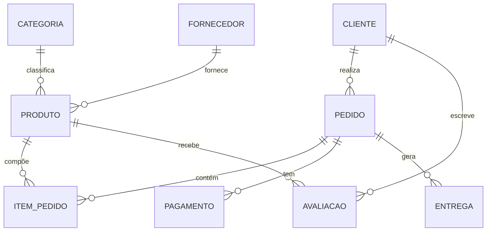

<div align="center">

# Loja de Eletrônicos

**Banco de dados relacional para uma loja virtual de produtos eletrônicos.**


</div>

---

## Sumário

1. [Sobre o projeto](#sobre-o-projeto)
2. [Objetivos](#objetivos)
3. [Estrutura do banco de dados](#estrutura-do-banco-de-dados)
4. [Modelo de dados](#modelo-de-dados)
5. [Consultas SQL](#consultas-sql)
6. [Conceitos aplicados](#conceitos-aplicados)
7. [Como executar](#como-executar)
8. [Organização do repositório](#organização-do-repositório)
9. [Possibilidades de evolução](#possibilidades-de-evolução)
10. [Autor](#autor)

---

## Sobre o projeto

Projeto acadêmico de Banco de Dados que modela as operações de uma loja virtual de eletrônicos: produtos, categorias, fornecedores, clientes, pedidos, pagamentos, entregas e avaliações.

Todo o banco, de criação das tabelas à inserção de dados e consultas, está em um único script SQL para MySQL, executável no MySQL Workbench.

---

## Objetivos

- Estruturar um banco de dados relacional para uma loja virtual.
- Organizar produtos, categorias e fornecedores.
- Representar clientes, pedidos e itens de compra.
- Registrar pagamentos, entregas e avaliações.
- Aplicar chaves primárias, chaves estrangeiras e integridade referencial.
- Desenvolver consultas SQL que combinem dados de várias tabelas.

---

## Estrutura do banco de dados

**Banco de dados:** `loja_eletronicos`

O banco possui **9 tabelas**:

| Tabela | Descrição |
| :--- | :--- |
| `Categoria` | Categorias usadas para classificar os produtos. |
| `Produto` | Produtos comercializados pela loja. |
| `Fornecedor` | Fornecedores associados aos produtos. |
| `Cliente` | Clientes cadastrados. |
| `Pedido` | Pedidos realizados pelos clientes. |
| `Item_Pedido` | Produtos que compõem cada pedido. |
| `Pagamento` | Pagamentos dos pedidos. |
| `Entrega` | Informações de entrega dos pedidos. |
| `Avaliacao` | Avaliações dos clientes sobre os produtos. |

---

## Modelo de dados



### Relacionamentos

| Relação | Descrição |
| :--- | :--- |
| Categoria e Produto | Cada produto pertence a uma categoria. |
| Fornecedor e Produto | Cada produto está associado a um fornecedor. |
| Cliente e Pedido | Cada pedido é feito por um cliente. |
| Pedido e Item_Pedido | Um pedido é composto por um ou mais itens. |
| Produto e Item_Pedido | Cada item de pedido refere-se a um produto. |
| Pedido e Pagamento | O pagamento está vinculado ao pedido. |
| Pedido e Entrega | A entrega está vinculada ao pedido. |
| Cliente, Produto e Avaliacao | A avaliação liga o cliente ao produto avaliado. |

A tabela `Item_Pedido` resolve o relacionamento muitos-para-muitos entre `Pedido` e `Produto`, e a tabela `Avaliacao` faz o mesmo entre `Cliente` e `Produto`.

> As cardinalidades do diagrama seguem o padrão de uma loja virtual. Confira com o seu script e ajuste, se necessário (por exemplo, `Pedido` e `Pagamento` como 1:1).

---

## Consultas SQL

O script contém **30 consultas** (numeradas de 01 a 30) que exploram os dados da loja, entre elas:

| Tema | Recursos utilizados |
| :--- | :--- |
| Produtos e suas categorias | `INNER JOIN`, `ORDER BY` |
| Fornecedores de cada produto | `INNER JOIN` |
| Pedidos por cliente | `JOIN`, `WHERE` |
| Itens de cada pedido | `JOIN` entre `Pedido`, `Item_Pedido` e `Produto` |
| Pagamentos e entregas dos pedidos | `JOIN`, filtros |
| Avaliações de produtos | `JOIN`, funções de agregação |
| Registros sem relacionamento (ex.: produtos nunca vendidos) | `LEFT JOIN`, `IS NULL` |

### Exemplo

```sql
-- Valor total de cada pedido, com o nome do cliente
SELECT
    c.nome                                  AS cliente,
    p.id_pedido                             AS pedido,
    SUM(ip.quantidade * ip.preco_unitario)  AS valor_total
FROM Pedido p
INNER JOIN Cliente c      ON c.id_cliente = p.id_cliente
INNER JOIN Item_Pedido ip ON ip.id_pedido = p.id_pedido
GROUP BY c.nome, p.id_pedido
ORDER BY valor_total DESC;
```

> Ajuste os nomes das colunas do exemplo para os mesmos usados no seu `desafio_loja.sql`.

---

## Conceitos aplicados

| Conceito | Aplicação no projeto |
| :--- | :--- |
| Modelagem de dados | Definição das entidades, tabelas e relacionamentos da loja. |
| Chaves primárias (`PRIMARY KEY`) | Identificação única dos registros de cada tabela. |
| Chaves estrangeiras (`FOREIGN KEY`) | Ligação entre produtos, pedidos, clientes, pagamentos e entregas. |
| Integridade referencial | Consistência dos relacionamentos entre os registros. |
| Consultas com `JOIN` | Combinação de dados de várias tabelas. |
| SQL | Criação de estruturas, inserção e consulta de dados. |

---

## Como executar

**Pré-requisitos:** [MySQL Server](https://dev.mysql.com/downloads/mysql/) e [MySQL Workbench](https://dev.mysql.com/downloads/workbench/).

```bash
git clone https://github.com/LipinnDEV/Loja-de-Eletronicos.git
cd Loja-de-Eletronicos
```

1. Abra o **MySQL Workbench** e conecte-se ao seu servidor local.
2. Abra o arquivo `desafio_loja.sql` (**File > Open SQL Script**).
3. Execute o script completo. Ele cria o banco, as tabelas, insere os dados e roda as consultas.
4. Confira os resultados de cada consulta (01 a 30) na aba de resultados.

---

## Organização do repositório

```
Loja-de-Eletronicos/
├── desafio_loja.sql    # Banco, tabelas, inserts e consultas 01 a 30
├── diagrama            # Diagrama do banco (MySQL Workbench)
├── apresentacao        # Apresentação do projeto
└── README.md
```

> Ajuste os nomes e extensões dos arquivos conforme o seu repositório.

---

## Possibilidades de evolução

- Diagrama entidade-relacionamento completo, com colunas e cardinalidades
- Consultas para produtos mais vendidos e histórico de compras por cliente
- Relatórios de faturamento por categoria e por período
- Revisão das restrições (`CHECK`, `UNIQUE`, `NOT NULL`) e das regras de exclusão em cascata
- Documentação detalhada das colunas de cada tabela

---

## Autor

**Felipe Mousinho**
Estudante do Ensino Médio Integrado em Desenvolvimento de Sistemas, SESI Blumenau, com interesse em programação, bancos de dados e desenvolvimento de software.

[](https://github.com/LipinnDEV)

---

<div align="center">

**Loja de Eletrônicos** · Projeto acadêmico de Banco de Dados · MySQL e SQL

</div>
